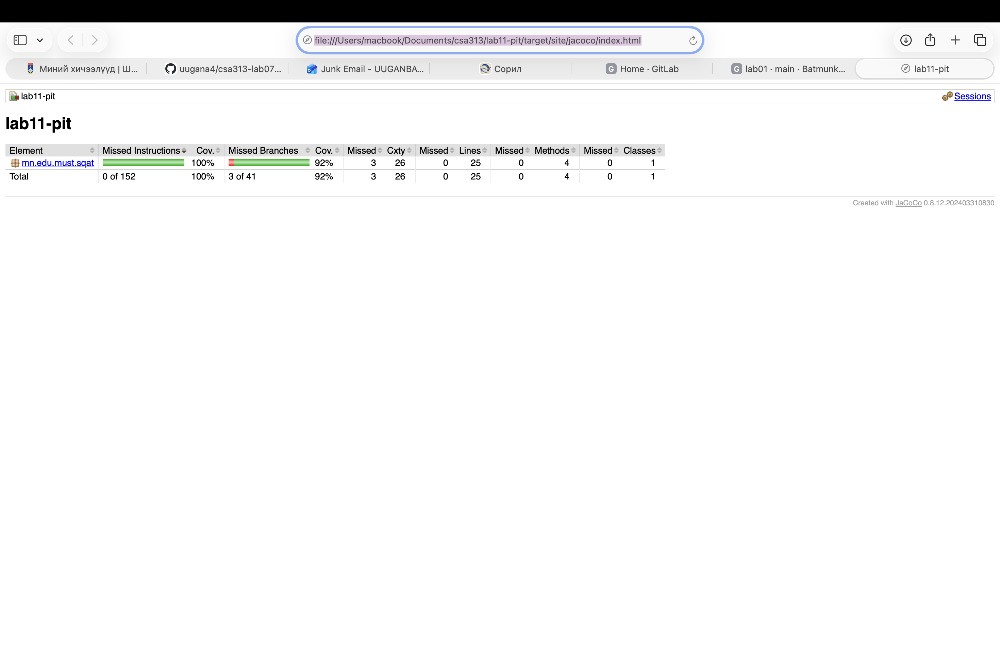

# Лаб 11 — Mutation testing (PIT)

- **Овог нэр:** А.Ууганбаяр
- **Оюутны код:** B242270014
- **GitHub:** uugana4

## Орчин

~~~text
openjdk version "17.0.21.1" 2026-11-17
OpenJDK Runtime Environment Homebrew (build 17.0.21.1+0)
OpenJDK 64-Bit Server VM Homebrew (build 17.0.21.1+0, mixed mode, sharing)
Apache Maven 3.10.2 (61b8bc355f4c4325463c22aa9afe4e7811a290f8)
Maven home: /opt/homebrew/Cellar/maven/3.10.2/libexec
Java version: 17.0.21.1, vendor: Homebrew, runtime: /opt/homebrew/Cellar/openjdk@17/17.0.21.1/libexec/openjdk.jdk/Contents/Home
Default locale: en_MN, platform encoding: UTF-8, time zone: Asia/Ulaanbaatar
OS name: "mac os x", version: "26.5.2", arch: "aarch64", family: "mac"
~~~

## Эхний хэмжилт

JaCoCo (`results/jacoco-start.csv`, `results/mvn-verify-start.txt`): **Line 25/25 (100%)**, **Branch 38/41** (3 нь хамрагдаагүй).

PIT (`results/pit-start.txt`): **Generated 63 mutations, Killed 17 (27%)**, Test strength 27%, 95 тест ажилласан. Амьд үлдсэн мутант 46 (`results/pit-mutants-start.txt`).

**Зөрүүний тайлбар.** JaCoCo Line Coverage 100% гэж харуулсан ч PIT 63 мутацийн зөвхөн 17-г (27%) барьсан. Энэ нь тестүүд кодын бүх мөрийг ажиллуулдаг боловч assertion нь сул (`assertNotNull`, муж шалгах) тул кодыг өөрчилсөн ч тест унадаггүйг харуулна. Хамралт нь код ажилласан эсэхийг, mutation score нь тест согогийг барьж чадах эсэхийг хэмждэг.

## A: Амьд мутантуудын ангилал

Эх сурвалж: `results/pit-mutants-start.txt` (46 амьд мутант). Ижил шалтгаантай мутантыг нэг мөрөнд нэгтгэв.

| Мөр | Мутаци (PIT-ийн тайлбар) | Тоо | Ангилал | Арга хэмжээ |
|-----|--------------------------|-----|---------|-------------|
| 20 | changed conditional boundary (`<0`→`<=0`, `>100`→`>=100`) | 2 | Тест дутуу | `letterGrade(0)="F"`, `letterGrade(100)="A"` |
| 23-26 | changed conditional boundary (`>=`→`>`) | 4 | Тест дутуу | 90/89.99, 80/79.99, 70/69.99, 60/59.99 |
| 23-26 | removed conditional (comparison → true / false) | 8 | Тест дутуу | яг үсэг: 95→A, 85→B, 75→C, 65→D |
| 23-27 | replaced return value with "" | 5 | Тест дутуу | `assertNotNull`-г `assertEquals("A"…"F")` болгоно |
| 36 | Changed switch default to be first case | 1 | Тест дутуу | F дүнтэй `gpa({40}) == 0.0` |
| 38, 40 | Replaced double addition with subtraction (B, D дүн) | 2 | Тест дутуу | `gpa({95,85}) == 3.5`, `gpa({75,65}) == 1.5` |
| 44 | replaced double return with 0.0 | 1 | Тест дутуу | яг утгын `assertEquals` |
| 48 | changed conditional boundary ×2, removed conditional ×1 | 3 | Тест дутуу | gpa=0, credits=0 хүчинтэй; gpa<0 шидэх |
| 51 | removed conditional (equality → true / false) | 2 | Тест дутуу | `(4.0,20,true)==0`, зөрчилгүй бол 100 |
| 52 | boundary ×2, removed conditional ×4, return 0 ×1 | 7 | Тест дутуу | (3.8,15)=100, (3.8,14)=70, (3.7,16)=70 |
| 53 | boundary ×2, removed conditional ×4, return 0 ×1 | 7 | Тест дутуу | (3.4,12)=70, (3.4,11)=50, (3.3,13)=50 |
| 54 | boundary ×1, removed conditional ×2, return 0 ×1 | 4 | Тест дутуу | (3.0,0)=50, (2.9,20)=0 |

Нийт 46 амьд мутант.

**Тест дутуу гэж үндэслэсэн нь:** эдгээр өөрчлөлт бодит зан төлөвийг өөрчилдөг (хил дээр өөр дүн, өөр хувь, өөр голч буцаадаг) боловч starter-ийн assertion зөвхөн `assertNotNull` болон муж шалгадаг, зааг утгыг огт шалгадаггүй тул ямар ч тест унадаггүй.

**Equivalent:** амьд мутантуудын нэгийг ч equivalent гэж ангилаагүй, учир нь тус бүр нь ямар нэг оролтод өөр үр дүн өгдөг тул тэр оролтыг шалгах тест бичиж алж болно.
