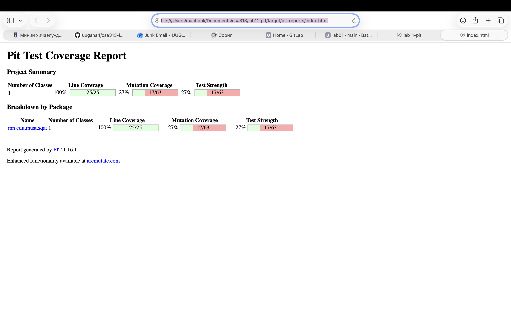
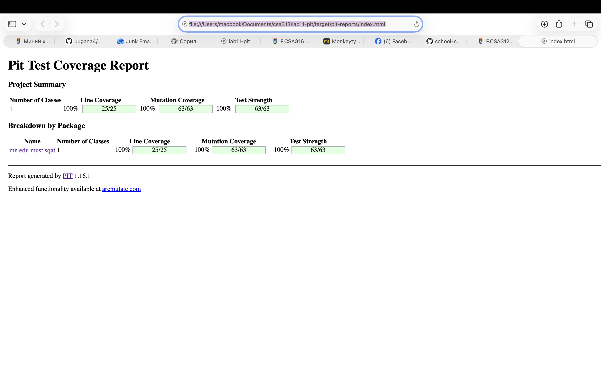

# Лаб 11 — Mutation testing (PIT)

- **Овог нэр:** А.Ууганбаяр
- **Оюутны код:** B242270014
- **GitHub:** uugana4

## Орчин

~~~text
openjdk version "17.0.21.1" 2026-11-17
OpenJDK Runtime Environment Homebrew (build 17.0.21.1+0)
OpenJDK 64-Bit Server VM Homebrew (build 17.0.21.1+0, mixed mode, sharing)
Apache Maven 3.10.2 (61b8bc355f4c4325463c22aa9afe4e7811a290f8)
Maven home: /opt/homebrew/Cellar/maven/3.10.2/libexec
Java version: 17.0.21.1, vendor: Homebrew, runtime: /opt/homebrew/Cellar/openjdk@17/17.0.21.1/libexec/openjdk.jdk/Contents/Home
Default locale: en_MN, platform encoding: UTF-8, time zone: Asia/Ulaanbaatar
OS name: "mac os x", version: "26.5.2", arch: "aarch64", family: "mac"
~~~

## Эхний хэмжилт

JaCoCo (`results/jacoco-start.csv`, `results/mvn-verify-start.txt`): **Line 25/25 (100%)**, **Branch 38/41** (3 нь хамрагдаагүй).

PIT (`results/pit-start.txt`): **Generated 63 mutations, Killed 17 (27%)**, Test strength 27%, 95 тест ажилласан. Амьд үлдсэн мутант 46 (`results/pit-mutants-start.txt`).

**Зөрүүний тайлбар.** JaCoCo Line Coverage 100% гэж харуулсан ч PIT 63 мутацийн зөвхөн 17-г (27%) барьсан. Энэ нь тестүүд кодын бүх мөрийг ажиллуулдаг боловч assertion нь сул (`assertNotNull`, муж шалгах) тул кодыг өөрчилсөн ч тест унадаггүйг харуулна. Хамралт нь код ажилласан эсэхийг, mutation score нь тест согогийг барьж чадах эсэхийг хэмждэг.

## A: Амьд мутантуудын ангилал

Эх сурвалж: `results/pit-mutants-start.txt` (46 амьд мутант). Ижил шалтгаантай мутантыг нэг мөрөнд нэгтгэв.

| Мөр | Мутаци (PIT-ийн тайлбар) | Тоо | Ангилал | Арга хэмжээ |
|-----|--------------------------|-----|---------|-------------|
| 20 | changed conditional boundary (`<0`→`<=0`, `>100`→`>=100`) | 2 | Тест дутуу | `letterGrade(0)="F"`, `letterGrade(100)="A"` |
| 23-26 | changed conditional boundary (`>=`→`>`) | 4 | Тест дутуу | 90/89.99, 80/79.99, 70/69.99, 60/59.99 |
| 23-26 | removed conditional (comparison → true / false) | 8 | Тест дутуу | яг үсэг: 95→A, 85→B, 75→C, 65→D |
| 23-27 | replaced return value with "" | 5 | Тест дутуу | `assertNotNull`-г `assertEquals("A"…"F")` болгоно |
| 36 | Changed switch default to be first case | 1 | Тест дутуу | F дүнтэй `gpa({40}) == 0.0` |
| 38, 40 | Replaced double addition with subtraction (B, D дүн) | 2 | Тест дутуу | `gpa({95,85}) == 3.5`, `gpa({75,65}) == 1.5` |
| 44 | replaced double return with 0.0 | 1 | Тест дутуу | яг утгын `assertEquals` |
| 48 | changed conditional boundary ×2, removed conditional ×1 | 3 | Тест дутуу | gpa=0, credits=0 хүчинтэй; gpa<0 шидэх |
| 51 | removed conditional (equality → true / false) | 2 | Тест дутуу | `(4.0,20,true)==0`, зөрчилгүй бол 100 |
| 52 | boundary ×2, removed conditional ×4, return 0 ×1 | 7 | Тест дутуу | (3.8,15)=100, (3.8,14)=70, (3.7,16)=70 |
| 53 | boundary ×2, removed conditional ×4, return 0 ×1 | 7 | Тест дутуу | (3.4,12)=70, (3.4,11)=50, (3.3,13)=50 |
| 54 | boundary ×1, removed conditional ×2, return 0 ×1 | 4 | Тест дутуу | (3.0,0)=50, (2.9,20)=0 |

Нийт 46 амьд мутант.

**Тест дутуу гэж үндэслэсэн нь:** эдгээр өөрчлөлт бодит зан төлөвийг өөрчилдөг (хил дээр өөр дүн, өөр хувь, өөр голч буцаадаг) боловч starter-ийн assertion зөвхөн `assertNotNull` болон муж шалгадаг, зааг утгыг огт шалгадаггүй тул ямар ч тест унадаггүй.

**Equivalent:** амьд мутантуудын нэгийг ч equivalent гэж ангилаагүй, учир нь тус бүр нь ямар нэг оролтод өөр үр дүн өгдөг тул тэр оролтыг шалгах тест бичиж алж болно.

## B: Тестүүдийг хүчтэй болгох

`src/main` өөрчлөгдөөгүй, зөвхөн тест засагдсан. Гурван хэмжилт:

| Хэмжилт | Commit | PIT: алагдсан / нийт | Mutation Coverage | Test strength | Файл |
|---------|--------|----------------------|-------------------|---------------|------|
| Эхлэл | `1528fd9` | 17 / 63 | 27% | 27% | `results/pit-start.txt` |
| B1 (яг утгын assertion) | `372ddf3` | 45 / 63 | 71% | 71% | `results/pit-B1.txt` |
| B2 (зааг утгууд) | `a478c2a` | 63 / 63 | 100% | 100% | `results/pit-B2.txt` |

**B1:** `assertNotNull(calc.letterGrade(95))`-г `assertEquals("A", calc.letterGrade(95))` болгож, `assertTrue(g >= 0 && g <= 4)` муж шалгалтыг `assertEquals(3.5, calc.gpa(...), 1e-9)` зэрэг яг утга болгосон. Оролтууд starter-тэй адил. Үр дүнд 27% -> 71% болсон боловч 18 мутант амьд үлдсэн: `ConditionalsBoundaryMutator` 13, `RemoveConditionalMutator_ORDER_IF` 5 (`results/pit-B1.txt`), энэ нь зааг утгын тест дутууг заасан.

**B2:** 11 шинэ тест нэмсэн: `letterGrade`-ийн 90/89.99, 80/79.99, 70/69.99, 60/59.99, 0, 100 ба хилийн гадуурх -0.01, 100.01; `gpa`-гийн switch-ийн үсэг бүр (A, B, C, D, F) тус тусдаа; `scholarship`-ийн 3.8/15, 3.4/12, 3.0 заагууд, оролтын хязгаар (gpa 0 ба 4, credits 0), хязгаараас гадуурх -0.01, 4.01, мөн сахилгын зөрчил. Нийт 17 тест, PIT 103 тест ажиллуулж 63 мутацийн **бүгдийг** алсан.

Эцсийн PIT тайлан (Mutation Coverage 100%, зорилт ≥ 85% хангагдсан):

## C: Гар мутант

`scholarship()`-ийн `gpa >= 3.8` нөхцлийг `gpa > 3.8` болгож гараар өөрчилсөн (`src/main` дахь нэг мөр), `mvn test` ажиллуулсан (`results/mvn-test-manual-mutant.txt`). **17 тестээс 1 нь унав:** `ScholarshipCalculatorTest.scholarship_fullTierBoundaries`, `ScholarshipCalculatorTest.java:112`, алдаа `expected: <100> but was: <70>`. Starter-ийн багц үүнийг барихгүй байсан, учир нь `scholarship_isAlwaysValidPercent` нь зөвхөн 0-100 муж шалгадаг ба 3.8 зааг дээр оролт байгаагүй (PIT-ийн эхний тайланд 52-р мөрийн boundary мутант амьд байсан). Дараа нь `git restore src/main`-оор буцаасан, мутацитай код commit-д ороогүй.

**Өөрийн equivalent мутант:** `letterGrade`-ийн `if (score >= 90) return "A";`-г `if (score >= 90 && score <= 100) return "A";` болгосон. 20-р мөрийн `score > 100` шалгалт өмнө нь `IllegalArgumentException` шидэж өгдөг тул энэ цэгт `score <= 100` үргэлж үнэн, нэмсэн нөхцөл зан төлөвийг огт өөрчилдөггүй. Иймд ямар ч оролтод эх код болон мутант ижил үр дүн өгдөг тул ямар ч тест барьж чадахгүй, бүх 17 тест өнгөрсөн (`results/mvn-test-equivalent-mutant.txt`, `Failures: 0`).

## Дүгнэлт

Line coverage нь кодын мөр ажилласан эсэхийг л хэмждэг бол mutation score нь кодыг өөрчлөхөд тест унаж байгаа эсэхийг хэмждэг: starter-ийн багц Line 100% (25/25) байсан ч PIT 63 мутацийн 17-г (27%) л барьсан. Starter-ийн тестүүд бүх мөрийг ажиллуулдаг ч `assertNotNull`, муж шалгалтаар бараг юу ч шалгадаггүй тул хамралт өндөр харагдсан. Assertion-уудыг яг утгын болгосноор (B1) 71%, зааг утгын тест нэмснээр (B2) 100% (63/63) болсон. B1-ийн дараа амьд үлдсэн 18 мутантын 13 нь boundary төрлийнх байсан нь зааг утгын тест хамгийн их мартагддаг гэдгийг харуулсан. Гар мутант B2-ийн зааг тестэд баригдсан бол өөрийн equivalent мутант ямар ч тестэд баригдаагүй нь 100%-д хүрэх нь үргэлж боломжтой биш, equivalent мутантыг үндэслэж ангилах ёстойг харуулж байна. AI-аар тест бичүүлбэл бүх салааг ажиллуулж өндөр хамралттай, тест нь өнгөрдөг мэт харагдах тест гарч болох тул assertion нь үнэхээр хатуу эсэхийг mutation score-оор шалгах хэрэгтэй. Тиймээс хамралт хэрэгтэй боловч хангалтгүй үзүүлэлт бөгөөд mutation score нь түүнийг нөхдөг.
